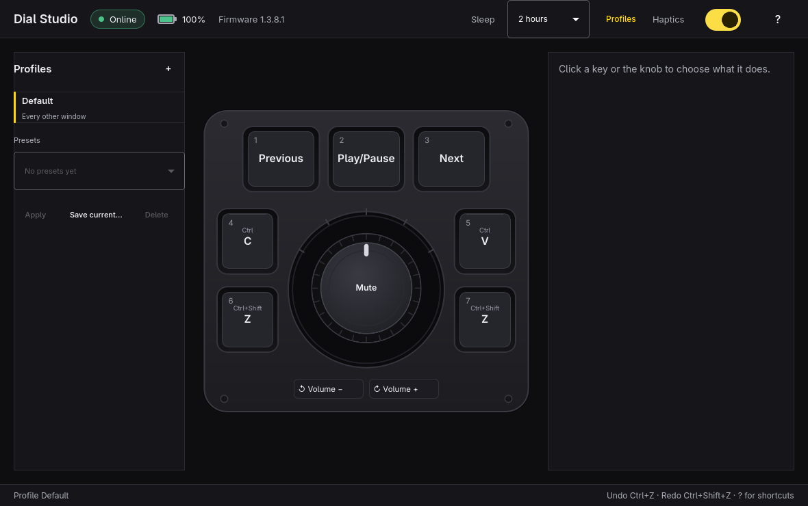

# Dial Studio



A Linux controller for the **Ulanzi D100H** dial (7 keys, one push-rotate knob, Bluetooth LE only),
built for Omarchy. It takes the dial over from its factory volume/media behaviour and lets each
control run commands, Hyprland dispatches, keystrokes, volume, media and brightness.

Status: **v0.1.5** adds the first window (`dialstudio open`) to the headless daemon and CLI of v0.1.0.
Profiles, pages and the full action library come in v0.2.0; see `PLAN.md`.

If the daemon stops, the dial goes back to its factory volume/media behaviour within about 3 s.
The firmware does that, not this program.

## Install

On Omarchy or Arch:

```sh
git clone https://github.com/Ex8-ca/dialstudio && cd dialstudio && bin/install
systemctl --user enable --now dialstudio
dialstudio doctor
```

`bin/install` runs `makepkg -fsi`. `install.sh` does the same from a one-liner and is safe to re-run.
The dial must already be paired (Omarchy menu, Setup, Bluetooth). No udev rule or group change is
needed: BlueZ's D-Bus API works for the logged-in user.

Optional tools, detected at runtime: `playerctl`, `swayosd-client`, `brightnessctl`, `notify-send`, `uwsm-app`.

## The window

`dialstudio open` (or the launcher entry) shows the dial, a header with the link state, battery,
firmware, a sleep-timer dropdown and a haptics switch, a profiles pane (toggle with the
**Profiles** button) and an inspector. It is a client of the daemon: it never starts one behind
your back. With no daemon it shows a banner with a **Start service** button, which runs
`systemctl --user enable --now dialstudio`.

- Click a key or the knob, pick the slot (press / long press, or one of the five knob gestures),
  choose an action. A complete action is saved at once through the daemon (atomic write, then hot reload).
- **Keyboard shortcut**: press **Record**, press the combo on the real keyboard (modifiers show as chips),
  or type it. Super is usually taken by Hyprland before the window sees it, so type those.
- **Omarchy shortcut**: pick one of Omarchy's own shortcuts from a searchable list. It is run, not typed (see below).
- **Launch app or command**: pick an installed .desktop application (localized list) or type a command.
- **Profiles pane**: add, rename and delete profiles; give a profile a window-class regex
  (type it, or pick a running window from the dropdown); add or remove pages; pin a profile
  manually. Edits save whole-list in one validated daemon save, so a mistake rolls back the pane.
- **Presets**: save the current profile list under a name, apply one, delete it
  (`~/.config/dialstudio/presets/`).
- **Test** runs the action now through the daemon.
- Real presses flash the matching key and turning the knob turns its picture. These come from the
  daemon's event stream; the screenshot above is an offscreen render, see `docs/hardware-test.md`
  for what was and was not checked on the dial.

| Key | Does |
|---|---|
| `?` | list the shortcuts |
| `Q` | quit |
| `Ctrl+Z` / `Ctrl+Shift+Z` | undo / redo (kept in memory for the session) |
| `Ctrl+R` | reload from the daemon |
| `Esc` | close the list, or stop recording |

The window follows the Omarchy accent colour and Hyprland's rounding, and the language chosen under
Setup, Language (Danish is translated so far; other languages show English).

## Controls

| Name | Physical control | Wire ID |
|---|---|---|
| `key1` `key2` `key3` | top row, left to right | 01 02 03 |
| `key4` | upper-left side key | 04 |
| `key5` | upper-right side key | 05 |
| `key6` | lower-left side key | 06 |
| `key7` | lower-right side key | 08 |
| `knob.click` | knob push (fires on release) | 07 |
| `knob.rotate_cw` / `knob.rotate_ccw` | turn | 0a / 09 |
| `knob.press_rotate_cw` / `_ccw` | turn while pressed | 0c / 0b |

Key slots are `press` (default), `long_press` and `release`. A knob rotation bound with
`@keyN`, for example `knob.rotate_cw@key4`, applies while that key is held, and the key's own
`press` is then cancelled. Press-rotate without a binding falls through to plain rotate.
The knob has no long press: the dial only reports a click on release.

## Commands

```
dialstudio daemon                      run the headless daemon (the systemd unit does this)
dialstudio status [--json]             link, device, battery, firmware, haptics, sleep, profile
dialstudio events [--json]             stream decoded events: "key1 press", "rotate cw steps=3", ...
dialstudio set haptics on|off          write the dial's setting (reply is the dial's own answer)
dialstudio set sleep <seconds>         0 disables
dialstudio profile <name>|auto         pin a profile, or go back to window matching
dialstudio page next|prev|<n>
dialstudio doctor [--json]             bluez, pairing, characteristics, tools, config, unit

dialstudio bind <control> <combo> [--on press|long_press|release] [--profile NAME] [--page N] [--via wtype|hypr]
dialstudio bind <control> --omarchy "Volume up"
dialstudio bind <control> --action '{"type":"exec","command":"foot"}'
dialstudio unbind <control> [--on SLOT]
dialstudio bindings [--json] [--profile NAME]
dialstudio send <combo> [--via wtype|hypr]
dialstudio shortcuts [--json] [FILTER]
dialstudio learn <control>
```

Every `bind` validates the combo (key names are checked against xkb keysyms, so `ctrl+Retrun` is
rejected), saves `~/.config/dialstudio/config.json` atomically, and the running daemon reloads it.

### Shortcut delivery

- `wtype` (default): synthesises the key press to the focused window.
- `hypr`: `hyprctl dispatch hl.dsp.send_shortcut(...)`, optionally aimed at a window.
- `--omarchy "description"`: links to one of Omarchy's own shortcuts and **runs what it does**.
  Hyprland ignores injected keys, so a bind cannot be triggered by sending its combo (tested, see
  `docs/hardware-test.md`), and `hyprctl binds` reports every Lua bind as `__lua`. Instead Dial Studio
  reads the source: it evaluates `~/.config/hypr/hyprland.lua` (which loads Omarchy's defaults from
  `/usr/share/omarchy`) in a plain `lua` interpreter against a stub `hl`, as `omarchy-menu-keybindings`
  does, and records every described bind with its command (`omarchy-launch-terminal`, ...) or Hyprland
  dispatch (`hl.dsp.window.close()`, ...). Nothing in your config is written. The link stores only the
  description. It is looked up again each time it fires and whenever Hyprland reloads its config, so a
  remapped key keeps working and a shortcut that disappears is reported in `dialstudio status` and
  in the window. A bind that is only a Lua function (for example the "Universal copy" family) has no
  command to run: `dialstudio shortcuts` marks it `not runnable` and `bind` refuses it with the reason.

`dialstudio shortcuts [FILTER]` lists the catalog; `--json` gives the same for scripts.

## Config

`~/.config/dialstudio/config.json`, written with defaults on first start (never overwritten). The
defaults reproduce the factory behaviour: media keys on the top row, copy/paste/undo/redo on the
side keys, volume on the knob, brightness on press-rotate. A broken file is never overwritten: the
daemon refuses to start, or keeps the previous config on a hot reload, and says why in
`dialstudio status` and `dialstudio events`.

Profiles switch with the focused window (Hyprland socket2 `activewindow`, regex on class and
optionally title; first match wins, `"match": null` is the fallback). Action types: `volume`, `mic`,
`brightness`, `media`, `keys`, `omarchy_bind`, `text`, `hypr`, `hypr_zoom`, `omarchy`, `exec`, `url`, `shell`,
`page`, `profile`, `haptics`, `multi`, `noop`. `exec` never goes through a shell; only `shell` does.

Hyprland actions use Lua because Hyprland 0.55+ dropped the old dispatcher syntax:
`{"type":"hypr","dispatch":"workspace","arg":"+1"}` runs `hyprctl dispatch 'hl.dsp.focus({ workspace = "+1" })'`.
For anything else use `{"type":"hypr","lua":"hl.dsp...."}`.

## Develop

```sh
bin/build      # qmake6 + make into build/dialstudio
bin/test       # unit tests offscreen, inside a private D-Bus session
```

The window is checked offscreen against a daemon with a throwaway config: `docs/gui-test.md`.
Needs `qt6-declarative`, `qt6-svg`, `qt6-wayland` and `lua` besides the daemon's dependencies.

`bin/test` never touches `~/.config` or the system bus: BlueZ is faked on a private session bus.

## License

MIT. See `LICENSE`.
